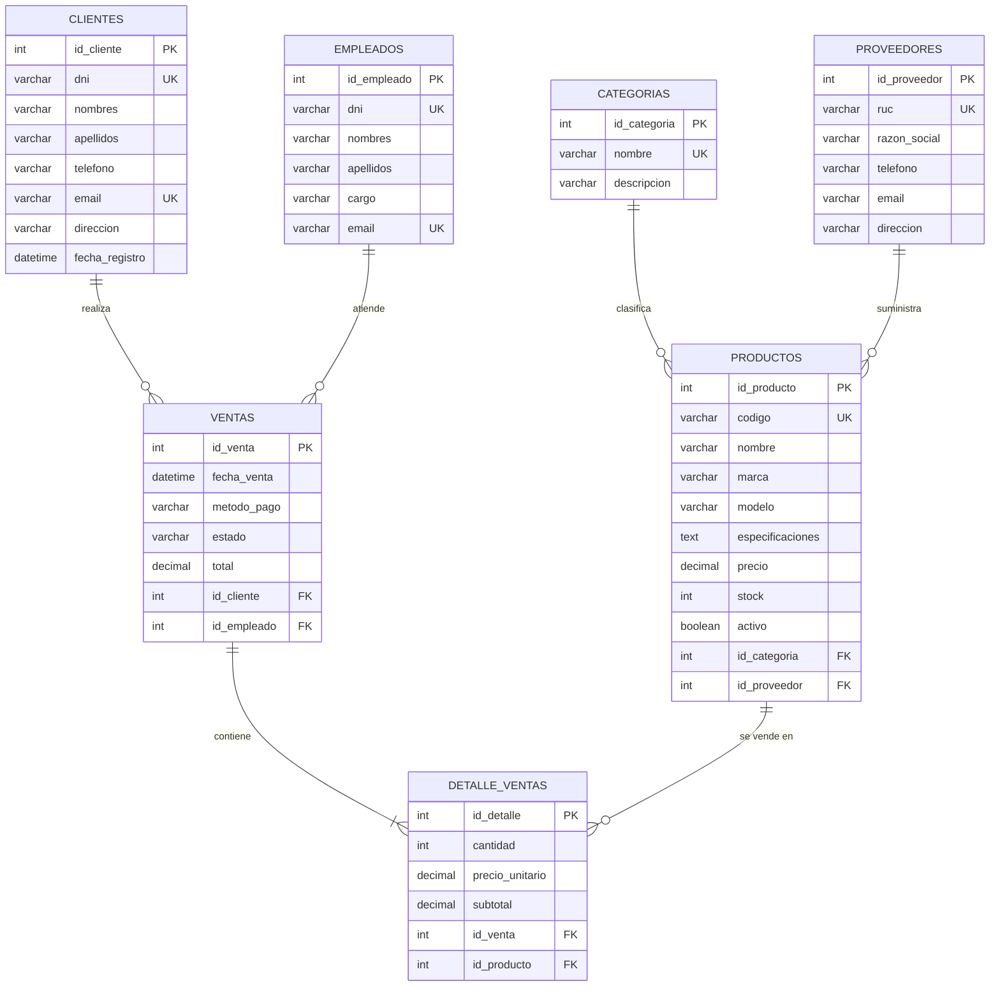

# Diagrama Entidad-Relación (DER)

> GitHub renderiza Mermaid automáticamente. Si tu docente pide una imagen, puedes pegar este código en <https://mermaid.live> y exportar PNG/SVG, y guardarla en `docs/DER.png`.

## Cardinalidades

| Relación                     | Cardinalidad | Explicación                                           |
|------------------------------|--------------|-------------------------------------------------------|
| Categorías – Productos       | 1 : N        | Una categoría tiene muchos productos                  |
| Proveedores – Productos      | 1 : N        | Un proveedor suministra muchos productos              |
| Clientes – Ventas            | 1 : N        | Un cliente puede realizar muchas ventas               |
| Empleados – Ventas           | 1 : N        | Un empleado atiende muchas ventas                     |
| Ventas – Detalle_Ventas      | 1 : N        | Una venta tiene uno o más ítems                       |
| Productos – Detalle_Ventas   | 1 : N        | Un producto aparece en muchos detalles                |
| Ventas – Productos           | N : M        | Resuelta con la tabla intermedia `detalle_ventas`     |
